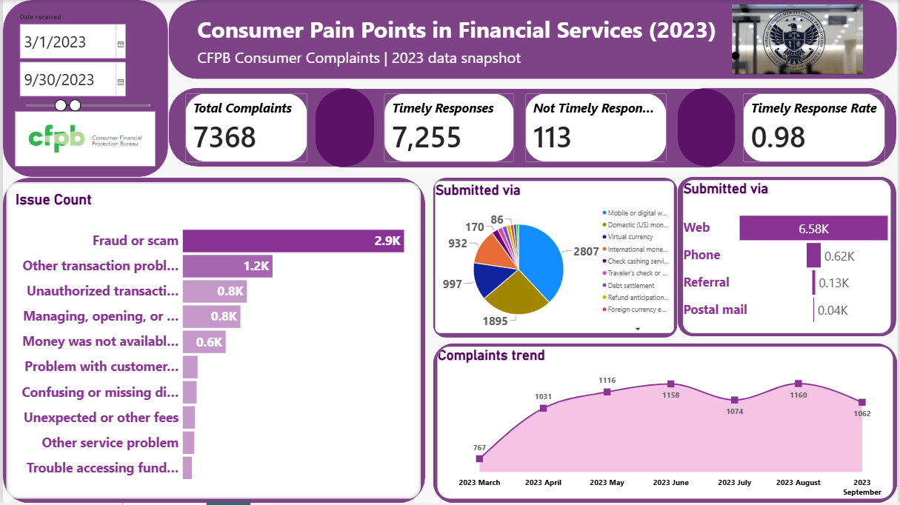

# Consumer Complaint Analysis

### Turning Consumer Complaints into Actionable Financial Insights

## Project Overview

This project explores consumer complaints in the financial services industry using data from the Consumer Financial Protection Bureau (CFPB) Consumer Complaint Database.

The analysis aims to identify major consumer pain points, understand recurring issues, examine product and company-level complaint patterns, and generate insights that can support better customer experiences and informed business decisions.

**Business Question:**

What are the biggest consumer pain points in financial services, how have they changed from 2021–2025, and which products, issues, and companies require the most attention?

## Business Problem

Financial service providers need to understand customer complaints to identify operational challenges, improve service delivery, and strengthen customer trust.

This project uses consumer complaint data to identify recurring problems and highlight areas that may require further investigation and improvement.

## Project Objectives

- Identify the most frequently reported consumer complaints.
- Examine complaint patterns across financial products and companies.
- Explore complaint volume over time within the available dataset.
- Analyse company-level complaint patterns.
- Evaluate timely responses to consumer complaints.
- Develop actionable recommendations for financial service providers.

## Dataset

**Source:** Consumer Financial Protection Bureau (CFPB)

- [CFPB Consumer Complaint Database](https://www.consumerfinance.gov/data-research/consumer-complaints/)
- [CFPB Data Use Guidelines](https://www.consumerfinance.gov/complaint/data-use/)

The current analysis focuses on complaints related to **Money transfer, virtual currency, or money service**.

### Dataset Limitation

The available dataset is a partial 2023 snapshot covering March to September. It does not provide complete coverage of the original 2021–2025 research period.

Consequently, the current findings represent patterns within the available data and cannot establish trends across the entire five-year period.

## Tools and Technologies

- **Microsoft Excel:** Data cleaning, validation, and preliminary analysis.
- **Power BI:** Data modelling, DAX calculations, dashboard development, and interactive visualisation.

## Analytical Approach

1. Business problem definition
2. Data collection and understanding
3. Data cleaning and validation
4. Exploratory data analysis (EDA)
5. Data modelling and calculations
6. Dashboard development
7. Insight generation and recommendations

## Key Areas of Analysis

- Complaint volume and distribution
- Most frequently reported issues
- Financial product complaint patterns
- Company-level complaint analysis
- Monthly complaint patterns
- Timely response performance

## Preliminary Findings

The initial analysis identified fraud or scam complaints, mobile and digital wallet issues, and company-level complaint patterns as important areas for investigation.

These findings provide a foundation for exploring potential customer pain points and identifying opportunities for operational improvement.

## Business Recommendations

The analysis may help financial service providers:

- Strengthen fraud prevention and investigation processes.
- Investigate recurring digital wallet transaction problems.
- Review complaint resolution processes.
- Monitor complaint patterns regularly.
- Improve customer support and communication.

## Project Deliverables

- Data analysis and validation
- Exploratory analysis
- Interactive Power BI dashboard
- Business insights and recommendations
- ## Dashboard Preview

## Disclaimer

Complaint counts do not necessarily indicate company wrongdoing or the prevalence of problems across all consumers. Findings should be interpreted within the dataset's coverage and limitations.

## Author

**Faith Atogun**
Data Analyst | Fintech Operations | Reconciliation & Settlement
